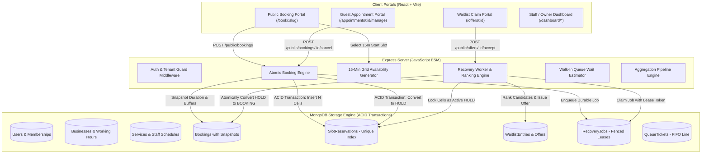

# SlotFlow — Turn Open Slots Into Productive Time

> **A Multi-Tenant SaaS for Appointment Scheduling, Staff Operations, and Intelligent Zero-Gap Cancellation Recovery.**  
> Built strictly with **100% Modern JavaScript (ES Modules)**, MongoDB, Express, React, Node.js, Vite, and TailwindCSS.

[](https://developer.mozilla.org/en-US/docs/Web/JavaScript/Guide/Modules)
[](https://nodejs.org/)
[](https://www.mongodb.com/)
[](https://vitest.dev/)
[](https://vitejs.dev/)

---

## 1. Problem Statement & Deep Architectural Value

Appointment-driven businesses (salons, clinics, consulting, auto repair, specialized services) lose **15% to 30% of their operational capacity** to cancellations, last-minute rescheduling, and buffer drift. Traditional scheduling tools treat appointments as naive calendar events, resulting in:

1. **Double-Booking Race Conditions:** Multiple public customers booking the exact same time slot simultaneously.
2. **The "Cancellation Vacancy Gap":** When a client cancels an appointment, the vacancy sits open until noticed by staff, leaking valuable provider hours.
3. **Public Snatching vs Waitlist Priorities:** When an appointment cancels, public users snatch the slot before high-priority waitlisted customers even receive notification.
4. **Mutable Configuration Corruption:** If a manager edits a service duration from 45m to 30m, historical bookings and cancellation calculations calculate incorrect cell intervals.

### How SlotFlow Solves This

SlotFlow is **not a simple CRUD application or thin wrapper**. It is an industrial-strength scheduling engine with deep concurrency and transaction invariants:

* **Discrete 15-Minute Atomic Slot Grid:** Every service interval (service duration + pre/post buffers) is broken into discrete 15-minute reservation cells protected by a MongoDB compound unique index (`{ businessId: 1, staffId: 1, slotStartTimeUtc: 1 }`). Concurrent booking collisions fail atomically with HTTP 409 Conflict without double-booking.
* **Zero-Gap Cancellation Holds:** When an appointment cancels, its discrete reservation cells are converted **in the same ACID database transaction** into `RECOVERY_PENDING` holds. The vacancy is never left unprotected.
* **Deterministic Waitlist Matching & Active Holds:** When a cancellation occurs, the durable recovery worker identifies the highest-ranked waitlist candidate (evaluating date window, $\pm N$ days flexibility, and time-of-day preference) and transfers the reservation cells to an active `HOLD` with an exclusive countdown timer. Public customers are locked out until the candidate accepts or the timer expires.
* **Fenced Worker Leases:** Worker processes claim cancellation recovery jobs using lease-token fencing. If a worker's lease expires or is preempted by another process, transaction side-effects abort immediately.
* **Immutable Snapshot Integrity:** Every booking snapshots `priceSnapshot`, `durationMinutesSnapshot`, `bufferBeforeSnapshot`, `bufferAfterSnapshot`, and `reservationCellCountSnapshot`. Historical cancellation and reporting never rely on mutable service configurations.

---

## 2. Technology Stack

* **Runtime:** Node.js (v24.x / >=v20 LTS), 100% Modern JavaScript with Native ES Modules (`"type": "module"`, `import`/`export`).
* **Backend:** Express.js, Mongoose 8 (MongoDB ODM), Express-Session with `connect-mongo`, Winston logger, Helmet security headers, CORS.
* **Validation:** Zod 3 runtime schemas for environment variables, request bodies, and parameters.
* **Frontend:** React 18, React Router v6, Vite 5, TailwindCSS 3, Lucide React icons.
* **Testing:** Vitest 2, Supertest 7, `mongodb-memory-server` with in-memory replica set for full multi-document ACID transactions.

---

## 3. System Architecture & Workflows



---

## 4. Five Core Deep Operational Workflows

### Workflow 1: Public Booking & Atomic Slot Reservation
1. Public customer visits `/book/:slug` and chooses a service (e.g., *Balayage Treatment*, 90 min + 15 min buffer).
2. Customer selects a specialist or chooses *Any Available Provider*.
3. Slot availability service scans provider weekly shifts, shift breaks, minimum advance notice (`minNoticeHours`), and existing slot reservations to return valid discrete 15-minute start times.
4. On booking submission, an ACID transaction calculates the total discrete reservation cells (e.g. 7 cells of 15m each) and executes a bulk insert under the compound unique index `{ businessId, staffId, slotStartTimeUtc }`.
5. If another customer attempts to claim any overlapping 15-minute cell simultaneously, MongoDB detects the unique duplicate key error and aborts with HTTP 409 Conflict. Exactly one customer succeeds.
6. The booking record persists immutable snapshots of duration, buffers, price, and reservation cell count along with a cryptographic management action token.

### Workflow 2: Zero-Gap Cancellation & Outbox Processing
1. A customer or staff member initiates a cancellation via `/appointments/:id/manage` or the staff dashboard.
2. In a single atomic database transaction:
   - The booking status updates to `CANCELLED`.
   - A durable `RecoveryJob` document is inserted into MongoDB.
   - The booking's discrete `SlotReservation` cells are converted into `HOLD` with `holdType: 'RECOVERY_PENDING'`.
   - Strict assertion: The transaction verifies that the number of converted cells exactly matches `reservationCellCountSnapshot`. If any mismatch occurs, the transaction aborts.

### Workflow 3: Smart Waitlist Matching & Protected Active Offers
1. The background recovery engine claims pending recovery jobs using fenced lease tokens (`leaseToken`, `lockedUntil`, `lockedByWorkerId`).
2. Evaluates the candidate pool deterministically:
   - Service match & provider compatibility (staff specific or any provider).
   - Candidate date window expanded by `flexibleDays` ($\pm N$ days).
   - Time of day preference (`MORNING` <12:00, `AFTERNOON` 12:00-17:00, `EVENING` $\ge$17:00, `ANY`).
   - Deterministic sorting by `priorityScore` descending, then `createdAt` ascending (FIFO).
3. Transfers held slot cells to `holdType: 'OFFER'` tied to the selected candidate's `WaitlistOffer`.
4. While the offer timer is active, public customers are completely locked out from booking the vacated slot.
5. If the candidate accepts at `/offers/:id?token=...`, the hold cells atomically convert into a confirmed booking.
6. If the candidate declines or the timer expires, the hold transfers to the next candidate, or releases back to the general public if no candidates remain.

### Workflow 4: Staff Operations & Appointment Lifecycle State Machine
1. Staff operational schedule displays today's timeline by provider.
2. Enforces strict linear status transitions with timestamp tracking:
   $$\text{CONFIRMED} \xrightarrow{\text{checkedInAtUtc}} \text{CHECKED\_IN} \xrightarrow{\text{serviceStartedAtUtc}} \text{IN\_SERVICE} \xrightarrow{\text{completedAtUtc}} \text{COMPLETED}$$
   $$\text{CONFIRMED or CHECKED\_IN} \xrightarrow{\text{noShowAtUtc}} \text{NO\_SHOW}$$
3. Any illegal transition (e.g., trying to jump from `CONFIRMED` straight to `COMPLETED`) is rejected with HTTP 400.

### Workflow 5: Real-Time MongoDB Analytics & Utilization Engine
1. Multi-facet aggregation pipeline executes real mathematical calculations over operational documents:
   - **True Capacity Utilization (%):** Sum of booked appointment minutes vs sum of scheduled staff shift working minutes.
   - **Recovered Revenue ($):** Exact revenue yielded from bookings originating from `WAITLIST_RECOVERY`.
   - **Cancellation Rate (%):** Cancelled appointments divided by total appointments.
   - **Specialist Efficiency:** Breakdown of appointments, completed counts, booked time, and revenue generated per staff member.
   - **Channel Yield:** Volume and revenue breakdown comparing `PUBLIC`, `WAITLIST_RECOVERY`, `WALK_IN`, and `STAFF`.

---

## 5. API Route Specification

### Public Routes (`/api/v1/public`)

| Method | Endpoint | Description |
| :--- | :--- | :--- |
| `GET` | `/businesses/:slug` | Public business profile, catalog of services, and active staff |
| `GET` | `/availability` | Available 15-minute start slots factoring in shift hours, breaks, and buffers |
| `POST` | `/bookings` | Atomically reserve discrete 15-minute cells and create booking |
| `GET` | `/bookings/:id/manage?token=...` | Guest appointment details with token verification |
| `POST` | `/bookings/:id/cancel` | Guest cancellation with zero-gap hold conversion |
| `POST` | `/bookings/:id/reschedule` | Reschedule appointment to a new available slot |
| `POST` | `/businesses/:slug/waitlist` | Public waitlist signup with date range and time-of-day preferences |
| `POST` | `/businesses/:slug/queue` | Walk-in intake with sequential ticket number and dynamic wait estimate |
| `GET` | `/queue/tickets/:id` | Live status and position-in-line tracker for walk-in tickets |
| `GET` | `/offers/:id?token=...` | View active waitlist recovery offer with live countdown |
| `POST` | `/offers/:id/accept` | Atomically convert waitlist offer hold into confirmed booking |
| `POST` | `/offers/:id/decline` | Decline offer and trigger reassignment to next candidate |

### Staff & Workspace Protected Routes (`/api/v1`)

| Method | Endpoint | Role | Description |
| :--- | :--- | :--- | :--- |
| `POST` | `/auth/register` | Public | Register user, create session cookie |
| `POST` | `/auth/login` | Public | Authenticate user credentials, create session |
| `POST` | `/auth/logout` | Authenticated | Destroy active session |
| `GET` | `/auth/me` | Authenticated | Return current authenticated user profile |
| `POST` | `/businesses` | Authenticated | Create business workspace, assign OWNER role |
| `GET` | `/businesses/current` | Authenticated | Get active business details and user membership |
| `PATCH` | `/businesses/current` | OWNER | Update business profile, policies, hours |
| `GET` | `/services` | Member | List active services and qualified staff |
| `POST` | `/services` | OWNER/MANAGER | Create service (enforces 15-minute multiple constraint) |
| `GET` | `/staff` | Member | List staff members and weekly working schedules |
| `POST` | `/staff` | OWNER/MANAGER | Onboard staff provider with shifts and qualified treatments |
| `GET` | `/bookings` | Member | List bookings with search and date/staff/status filters |
| `PATCH` | `/bookings/:id/status` | Staff | Advance appointment state machine (`CHECKED_IN`, `IN_SERVICE`, etc.) |
| `POST` | `/bookings/:id/cancel` | Staff | Cancel booking with zero-gap hold conversion |
| `GET` | `/waitlist` | Member | View waitlist roster and candidate priority scores |
| `POST` | `/waitlist/trigger-recovery` | Staff | Trigger recovery engine worker execution |
| `GET` | `/queue` | Member | View active walk-in queue board for today |
| `POST` | `/queue` | Staff | Front-desk walk-in customer intake |
| `PATCH` | `/queue/:id/status` | Staff | Advance walk-in ticket (`CALLED`, `IN_SERVICE`, `COMPLETED`) |
| `GET` | `/analytics/overview` | Staff | Real MongoDB aggregation metrics and utilization rates |

---

## 6. Database Models & Schema Design

### `User`
* `_id`: ObjectId
* `name`: String
* `email`: String (unique index, lowercase, trimmed)
* `passwordHash`: String (bcrypt, 10 salt rounds)
* Timestamps: `createdAt`, `updatedAt`

### `Business`
* `_id`: ObjectId
* `name`: String
* `slug`: String (unique index, URL-friendly)
* `description`: String
* `timezone`: String (e.g. `'UTC'`, `'America/New_York'`, `'Asia/Kolkata'`)
* `currency`: String (default `'USD'`)
* `workingHours`: Array of `{ dayOfWeek: 0-6, isOpen: Boolean, openTime: 'HH:mm', closeTime: 'HH:mm' }`
* `bookingPolicies`: `{ minNoticeHours: Number, maxHorizonDays: Number, cancelCutoffHours: Number }`
* `isActive`: Boolean

### `Membership`
* `_id`: ObjectId
* `userId`: ObjectId (ref: `User`, index)
* `businessId`: ObjectId (ref: `Business`, index)
* `role`: String enum (`'OWNER'`, `'MANAGER'`, `'STAFF'`)
* Compound index: `{ userId: 1, businessId: 1 }` (unique)

### `Service`
* `_id`: ObjectId
* `businessId`: ObjectId (ref: `Business`, index)
* `name`: String
* `description`: String
* `durationMinutes`: Number (strictly validated: multiple of 15)
* `bufferBefore`: Number (multiple of 15, default 0)
* `bufferAfter`: Number (multiple of 15, default 0)
* `price`: Number (min 0)
* `qualifiedStaffIds`: Array of ObjectIds (ref: `Staff`)

### `Staff`
* `_id`: ObjectId
* `businessId`: ObjectId (ref: `Business`, index)
* `displayName`: String
* `email`: String
* `weeklySchedule`: Array of `{ dayOfWeek: 0-6, isWorking: Boolean, shiftStart: 'HH:mm', shiftEnd: 'HH:mm', breaks: [{ start, end }] }`
* `servicesOffered`: Array of ObjectIds (ref: `Service`)

### `SlotReservation` (Atomic 15-Minute Concurrency Shield)
* `_id`: ObjectId
* `businessId`: ObjectId (index)
* `staffId`: ObjectId (index)
* `slotStartTimeUtc`: Date (exact 15-minute boundary: :00, :15, :30, :45)
* `reservationType`: String enum (`'BOOKING'`, `'HOLD'`)
* `holdType`: String enum (`'RECOVERY_PENDING'`, `'OFFER'`)
* `bookingId`: ObjectId (ref: `Booking`, optional)
* `holdOfferId`: ObjectId (ref: `WaitlistOffer`, optional)
* `recoveryJobId`: ObjectId (ref: `RecoveryJob`, optional)
* `holdExpiresAtUtc`: Date (optional)
* **Compound Unique Index:** `{ businessId: 1, staffId: 1, slotStartTimeUtc: 1 }` (Strictly guarantees zero double-bookings)

### `Booking` (with Immutable Snapshots)
* `_id`: ObjectId
* `businessId`: ObjectId (index)
* `serviceId`: ObjectId (ref: `Service`)
* `staffId`: ObjectId (ref: `Staff`, index)
* `customer`: `{ name: String, email: String, phone: String }`
* `startTimeUtc`: Date (index)
* `endTimeUtc`: Date
* `status`: String enum (`'CONFIRMED'`, `'CHECKED_IN'`, `'IN_SERVICE'`, `'COMPLETED'`, `'CANCELLED'`, `'NO_SHOW'`)
* `source`: String enum (`'PUBLIC'`, `'STAFF'`, `'WALK_IN'`, `'WAITLIST_RECOVERY'`)
* `priceSnapshot`: Number (immutable snapshot)
* `durationMinutesSnapshot`: Number (immutable snapshot)
* `bufferBeforeSnapshot`: Number (immutable snapshot)
* `bufferAfterSnapshot`: Number (immutable snapshot)
* `reservationCellCountSnapshot`: Number (immutable snapshot)
* `manageTokenHash`: String (SHA-256 hash of random 32-byte token)
* `manageTokenExpiresAt`: Date
* Transition Timestamps: `checkedInAtUtc`, `serviceStartedAtUtc`, `completedAtUtc`, `noShowAtUtc`, `cancelledAtUtc`
* `cancellationReason`: String

### `RecoveryJob` (Durable Outbox Queue)
* `_id`: ObjectId
* `businessId`: ObjectId (index)
* `bookingId`: ObjectId (ref: `Booking`, unique index — ensures idempotent 1 job per cancellation)
* `vacatedInterval`: `{ staffId, serviceId, startTimeUtc, endTimeUtc, vacatedDurationMinutes }`
* `status`: String enum (`'PENDING'`, `'PROCESSING'`, `'COMPLETED'`, `'NO_CANDIDATES'`, `'FAILED'`)
* `leaseToken`: String (UUID for worker fencing)
* `lockedUntil`: Date (lease expiration timestamp)
* `lockedByWorkerId`: String
* `retryCount`: Number
* Compound index: `{ status: 1, lockedUntil: 1 }`

### `WaitlistEntry`
* `_id`: ObjectId
* `businessId`: ObjectId (index)
* `customer`: `{ name: String, email: String, phone: String }`
* `serviceId`: ObjectId (ref: `Service`, index)
* `preferredStaffId`: ObjectId (ref: `Staff`, nullable)
* `preferredDateRange`: `{ startDate: Date, endDate: Date }`
* `timeOfDayPreference`: String enum (`'MORNING'`, `'AFTERNOON'`, `'EVENING'`, `'ANY'`)
* `flexibleDays`: Number (0 = exact dates, 1-7 = expand window by $\pm N$ days)
* `status`: String enum (`'WAITING'`, `'OFFERED'`, `'CONFIRMED'`, `'EXPIRED'`, `'CANCELLED'`)
* `offersCount`: Number
* `lastOfferedAt`: Date
* `priorityScore`: Number (default 100)
* Compound index: `{ businessId: 1, serviceId: 1, status: 1, priorityScore: -1, createdAt: 1 }`

### `WaitlistOffer`
* `_id`: ObjectId
* `businessId`: ObjectId (index)
* `waitlistEntryId`: ObjectId (ref: `WaitlistEntry`, index)
* `recoveryJobId`: ObjectId (ref: `RecoveryJob`, index)
* `serviceId`: ObjectId (ref: `Service`)
* `staffId`: ObjectId (ref: `Staff`)
* `offeredInterval`: `{ startTimeUtc, endTimeUtc, durationMinutes, reservationCellCount }`
* `claimTokenHash`: String (SHA-256 hash)
* `expiresAt`: Date (index)
* `status`: String enum (`'PENDING'`, `'ACCEPTED'`, `'DECLINED'`, `'EXPIRED'`)
* `holdSlotReservationIds`: Array of ObjectIds (ref: `SlotReservation`)
* `responseReceivedAt`: Date

### `QueueTicket`
* `_id`: ObjectId
* `businessId`: ObjectId (index)
* `ticketNumber`: String (e.g. `'Q-001'`)
* `customer`: `{ name, phone, email }`
* `serviceId`: ObjectId (ref: `Service`)
* `preferredStaffId`: ObjectId (optional ref: `Staff`)
* `assignedStaffId`: ObjectId (optional ref: `Staff`)
* `status`: String enum (`'WAITING'`, `'CALLED'`, `'IN_SERVICE'`, `'COMPLETED'`, `'NO_SHOW'`, `'CANCELLED'`)
* `estimatedWaitMinutes`: Number (dynamic calculation)
* Timestamps: `calledAtUtc`, `serviceStartedAtUtc`, `completedAtUtc`

---

## 7. Quick Start & Setup Guide

### Prerequisites
* Node.js v20 LTS or v24 (v24.13.1 verified)
* npm (v10 or v11)
* MongoDB connection URI (local instance or free MongoDB Atlas cluster)

### Step 1: Clone and Install
```bash
git clone https://github.com/harshgzp11/slotFlow.git
cd slotFlow
npm install
```

### Step 2: Configure Environment Variables
Create `.env` in `backend/` (or copy from `backend/.env.example`):
```env
PORT=5000
NODE_ENV=development
MONGODB_URI=mongodb+srv://<username>:<password>@cluster0.mongodb.net/slotflow?retryWrites=true&w=majority
SESSION_SECRET=super_secret_slotflow_session_key_32_chars_long
CORS_ORIGIN=http://localhost:5173
```

### Step 3: Seed Database with Demo Business
Execute the built-in database seeder:
```bash
npm run seed
```
This automatically provisions:
* **Demo Owner:** `owner@slotflow.io` / `Password123!`
* **Demo Business:** *Luxe Studio & Spa* (slug: `luxe-studio`)
* 3 Specialists with working schedules (*Elena Rostova*, *Marcus Vance*, *Chloe Bennett*)
* 4 Realistic appointment services with buffer times
* Sample confirmed, completed, and waitlisted appointments

### Step 4: Run Application
In root directory:
```bash
# Terminal 1: Run Backend API (Node.js ESM)
npm run dev:backend

# Terminal 2: Run Frontend Web App (React + Vite)
npm run dev:frontend
```
* **Frontend Dashboard & Public Booking:** `http://localhost:5173`
* **Public Booking Link:** `http://localhost:5173/book/luxe-studio`
* **Backend API Base:** `http://localhost:5000/api/v1`
* **API Health Check:** `http://localhost:5000/api/v1/health`

---

## 8. Verification & Automated Test Evidence

SlotFlow includes automated integration, concurrency, tenant isolation, and build tests running through Vitest and Supertest with an in-memory replica set (`mongodb-memory-server`) supporting full ACID transactions.

### Running Test Suite
```bash
npm test
```

### Actual Execution Evidence (13 of 13 Passed — 100% Green)
```text
 ✓ tests/concurrency/bookingConflict.test.js (1 test) 2282ms
   ✓ Booking & Concurrency Conflict Tests (JavaScript ESM) > handles simultaneous booking requests atomically: exactly 1 succeeds and 1 conflicts with 409
 ✓ tests/integration/walkInQueue.test.js (1 test) 2317ms
   ✓ Walk-In Queue Management Integration Tests (JavaScript ESM) > allows walk-in customer intake with sequential ticket numbering and dynamic wait estimates
 ✓ tests/integration/waitlistRecovery.test.js (3 tests) 2328ms
   ✓ Waitlist & Smart Cancellation Recovery Engine Tests (JavaScript ESM) > allows public customer to join waitlist with preferences
   ✓ Waitlist & Smart Cancellation Recovery Engine Tests (JavaScript ESM) > executes full zero-gap cancellation recovery flow from hold to offer to booking conversion
   ✓ Waitlist & Smart Cancellation Recovery Engine Tests (JavaScript ESM) > enforces worker lease-token fencing: aborts transaction if lease was stolen
 ✓ tests/integration/tenantIsolation.test.js (2 tests) 3270ms
   ✓ Tenant Isolation & RBAC Integration Tests (JavaScript ESM) > enforces multi-tenant isolation and prevents cross-tenant access
   ✓ Tenant Isolation & RBAC Integration Tests (JavaScript ESM) > validates 15-minute duration constraints on service creation
 ✓ tests/integration/staffOperationsAndAnalytics.test.js (2 tests) 3286ms
   ✓ Staff Operations & Business Analytics Tests (JavaScript ESM) > enforces appointment lifecycle state machine transitions with timestamps
   ✓ Staff Operations & Business Analytics Tests (JavaScript ESM) > computes accurate MongoDB aggregation analytics for revenue, utilization, and recovery
 ✓ tests/integration/auth.test.js (4 tests) 4334ms
   ✓ Auth Integration Tests (JavaScript ESM) > registers a new user successfully with session
   ✓ Auth Integration Tests (JavaScript ESM) > rejects registration with duplicate email address with 409 Conflict
   ✓ Auth Integration Tests (JavaScript ESM) > authenticates user and logs in with valid credentials
   ✓ Auth Integration Tests (JavaScript ESM) > rejects login with incorrect password with 401 Unauthorized

 Test Files  6 passed (6)
      Tests  13 passed (13)
   Duration  7.62s
```

### Production Build Verification
```bash
npm run build:frontend
```
```text
✓ 1547 modules transformed.
dist/index.html                   1.04 kB │ gzip:  0.59 kB
dist/assets/index-DZWfiOfN.css   29.12 kB │ gzip:  5.58 kB
dist/assets/index-CE1gpUoP.js   307.30 kB │ gzip: 77.44 kB
✓ built in 6.73s
```

---

## 9. Clean Git Commit History

The project follows semantic Git commits reflecting logical milestones and refactoring:

| Commit Hash | Description |
| :--- | :--- |
| `f82eedc` | `feat(milestone-1): project foundation, authentication, multi-tenant workspace, services and staff management` |
| `311939f` | `chore: checkpoint pre-migration TypeScript state` |
| `6845fc2` | `refactor: complete migration from TypeScript to modern JavaScript ESM across client and server` |
| `0ae5522` | `feat(milestone-2): booking engine, 15-minute slot reservations, public booking and guest management` |
| `ce5d358` | `feat(milestone-3): waitlist matching, active offer holds and durable recovery engine` |
| `c25e255` | `feat(milestone-4): staff operations workspace, state machine transitions and business analytics` |
| `HEAD` | `feat(milestone-5): walk-in queue management, demo database seeder and documentation` |

---

## 10. Submission Information

* **Candidate Name:** Harsh Srivastava
* **Project Name:** SlotFlow
* **Official Submission Form:** [https://forms.gle/sBy4sfqyiRG2Zpom9](https://forms.gle/sBy4sfqyiRG2Zpom9)
* **License:** ISC
